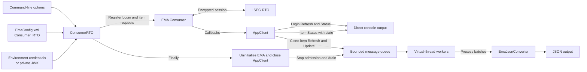
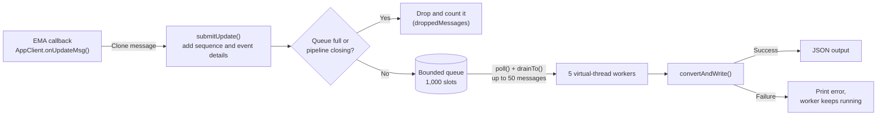

# Building an EMA Java Consumer with Java 17 and Java 21 Features

## Overview

**Last Updated**: October 2026

Java 17 and Java 21 are Long-Term Support (LTS) releases that add useful language and concurrency features to Java applications. However, a feature is easier to understand when we see it solving a real application problem instead of looking at an isolated example.

This article demonstrates Java 17 and 21 features through an [Enterprise Message API - Java Edition (EMA Java)](https://developers.lseg.com/en/api-catalog/real-time-opnsrc/rt-sdk-java) consumer application that connects to the LSEG Real-Time Optimized (RTO) service. The application requests one or more instruments, receives streaming market data, and converts item Refresh and Update messages to JSON.

The example uses the following modern Java features. Java 17 includes everything finalized in Java 12 to 17, so the list shows the release where each feature became final:

| Feature | Final in | Where it appears |
| --- | --- | --- |
| [`switch` expressions](https://openjdk.org/jeps/361) with arrow labels | Java 14 | Request selection and command-line parsing |
| [Text blocks](https://openjdk.org/jeps/378) | Java 15 | Command-line help text |
| [Pattern matching for `instanceof`](https://openjdk.org/jeps/394) | Java 16 | Reading the Refresh state in the JSON converter |
| [Records](https://openjdk.org/jeps/395) | Java 16 | Requests, queued messages, and callback details |
| `Stream.toList()` | Java 16 | Immutable lists of validated item names |
| [Sealed interfaces](https://openjdk.org/jeps/409) | Java 17 | Request and queued-message hierarchies |
| [Pattern matching for `switch`](https://openjdk.org/jeps/441) | Java 21 | Message type and field value conversion |
| [Record patterns](https://openjdk.org/jeps/440) | Java 21 | Single and batch request registration |
| [`List.getFirst()`](https://docs.oracle.com/en/java/javase/21/docs/api/java.base/java/util/List.html#getFirst()) | Java 21 | Single-item request selection |
| [Virtual threads](https://openjdk.org/jeps/444) | Java 21 | JSON worker tasks |

The main focus is how these features help the application model requests, route messages, run asynchronous work, and shut down cleanly.

The walkthrough follows `ConsumerRTO.java`, `AppClient.java`, `MessageProcessingPipeline.java`, and `EmaJsonConverter.java`, with a brief look at `Utility.java` where it supports the main flow.

**Note**

This POC is intended for demonstration and educational purposes only and is **not designed for production use**. The source code prioritizes clarity and ease of understanding over performance, scalability, and production-grade practices. Do not use this project as-is in a production environment. The author assumes no responsibility for any issues arising from its use.

## Prerequisites

Before going further, you need the following:

- Java Development Kit (JDK) 21
- Apache Maven
- LSEG RTO access, service entitlements, and network connectivity
- A Version 2 client ID with either a client secret or a private JWK file

Please check that the selected JDK and EMA release are supported in the [RTSDK Java API Compatibility Matrix](https://developers.lseg.com/en/api-catalog/real-time-opnsrc/rt-sdk-java/documentation#api-compatibility-matrix).

The application reads the client ID from the `RTO_CLIENTID_V2_1` environment variable and the client secret from `RTO_CLIENTSECRET_1`. JWK authentication is also supported with the `-jwkFile` option.

> **Security:** Never put a real client ID, client secret, private JWK, proxy password, or keystore password in source code or source control. Use environment variables or an external secret manager.

That covers the prerequisites of this example.

## Application Flow

Let’s start with the basic flow of the application.



The flow can be summarized as follows:

1. `ConsumerRTO` reads command-line options and validates the RTO credentials.
2. It creates an EMA consumer and registers Login and item requests.
3. EMA receives data from RTO and invokes `AppClient` callbacks.
4. Login and Status messages are handled directly.
5. Item Refresh and Update messages are cloned and placed in a bounded queue.
6. Virtual-thread workers process queued messages in batches.
7. `EmaJsonConverter` converts each message to JSON.
8. During shutdown, EMA is uninitialized and the accepted queue content is drained.

Now we can look at each part step-by-step.

## ConsumerRTO: Starting the EMA Consumer

That brings us to an entry point of the application, the `ConsumerRTO` class. It owns the startup flow, validates request data, opens the EMA consumer, and guarantees cleanup.

### Default Service, Item, and Field View

The application defaults to the `ELEKTRON_DD` service and the `/THB=` item. These values can be changed with the `-serviceName` and `-itemNames` command-line options.

Each item request also contains a field ID View:

```java
private static final int[] VIEW_FIELD_IDS = {
        3,    // DSPLY_NAME
        11,   // NETCHNG_1
        22,   // BID
        25,   // ASK
        3386, // QUOTE_DATE
        1025  // QUOTIM
};
```

A View asks the service to send only the selected fields instead of every field available for the item. Both single-item and batch requests use the same View in this example.

### Modeling Requests with a Sealed Interface

A request in this application can have only two forms: one item or a batch of items. The code models this rule with a sealed interface:

```java
private sealed interface ItemRequest permits SingleItemRequest, BatchItemRequest {

    static ItemRequest create(String serviceName, String[] itemNames) {
        Objects.requireNonNull(itemNames, "Item names must not be null.");

        List<String> validatedItemNames = Arrays.stream(itemNames)
                .map(itemName -> requireNonBlank(itemName, "Item name"))
                .toList();

        return switch (validatedItemNames.size()) {
            case 0 -> throw new IllegalArgumentException(
                    "At least one item name is required.");
            case 1 -> new SingleItemRequest(
                    serviceName, validatedItemNames.getFirst());
            default -> new BatchItemRequest(serviceName, validatedItemNames);
        };
    }
}
```

A sealed interface is a Java feature that restricts which classes can implement it. Here, the compiler knows that an `ItemRequest` must be either `SingleItemRequest` or `BatchItemRequest`. Another request type cannot appear unexpectedly.

The factory method also demonstrates a few other modern Java APIs:

- A Stream validates every item name.
- `Stream.toList()` returns an unmodifiable list.
- `List.getFirst()` expresses the intention more clearly than `get(0)` for the single-item case.
- A `switch` expression (Java 14) selects and returns the correct request type. The arrow labels (`->`) never fall through to the next case, so no `break` is needed.

`List.getFirst()` is new in Java 21 through the sequenced collections APIs.

### Storing Request Data with Records

The two permitted request types are records:

```java
private record SingleItemRequest(
        String serviceName,
        String itemName) implements ItemRequest {

    private SingleItemRequest {
        serviceName = requireNonBlank(serviceName, "Service name");
        itemName = requireNonBlank(itemName, "Item name");
    }
}

private record BatchItemRequest(
        String serviceName,
        List<String> itemNames) implements ItemRequest {

    private BatchItemRequest {
        serviceName = requireNonBlank(serviceName, "Service name");
        Objects.requireNonNull(itemNames, "Item names must not be null.");

        itemNames = itemNames.stream()
                .map(itemName -> requireNonBlank(itemName, "Item name"))
                .toList();

        if (itemNames.size() < 2)
            throw new IllegalArgumentException(
                    "A batch request requires at least two item names.");
    }
}
```

Records became final in Java 16 and are available in Java 17. They are designed for small data carriers and automatically provide accessors, equality, hash code, and a readable `toString()` implementation.

The compact constructors above add the business rules:

- A single request must contain exactly one valid item.
- A batch request must contain at least two items.
- Service and item names cannot be blank.
- The batch rebuilds the list so the record does not retain caller-owned mutable data.

This is a good use of records because the application needs immutable request data, not classes with changing internal state.

### Java 21 Record Patterns in switch

The sealed hierarchy becomes more useful when the request is registered with EMA:

```java
switch (itemRequest) {
    case SingleItemRequest(String serviceName, String itemName) ->
            consumer.registerClient(
                    EmaFactory.createReqMsg()
                            .serviceName(serviceName)
                            .name(itemName)
                            .payload(payload),
                    appClient);

    case BatchItemRequest(String serviceName, List<String> itemNames) -> {
        payload.add(EmaFactory.createElementEntry().array(
                EmaRdm.ENAME_BATCH_ITEM_LIST,
                createBatchItemArray(itemNames)));
        consumer.registerClient(
                EmaFactory.createReqMsg()
                        .serviceName(serviceName)
                        .payload(payload),
                appClient);
    }
}
```

Java 21 record patterns unpack the record components directly in each `case`. The code gets `serviceName`, `itemName`, or `itemNames` without manual casts and accessor calls.

There is no `default` branch. Because `ItemRequest` is sealed and every permitted type is handled, the compiler can verify that the `switch` is exhaustive. If a new request type is added later, this `switch` must also be updated or the application will not compile.

For the single request, EMA receives the item name in the request message. For the batch request, item names are placed in the `:ItemList` array inside the request payload. Both forms include the same field View.

### Opening the RTO Session and Registering Requests

The `run()` method, called from `main()`, brings those pieces together:

```java
OmmConsumerConfig config = EmaFactory.createOmmConsumerConfig();

switch (Utility.readCommandlineArgs(args, config)) {
    case CONTINUE -> { }
    case HELP_SHOWN -> { return EXIT_SUCCESS; }
    case INVALID -> { return EXIT_FAILURE; }
}

if (!applyEnvironmentCredentials(config))
    return EXIT_FAILURE;

appClient = new AppClient();
ItemRequest itemRequest = ItemRequest.create(
        Utility.serviceName, Utility.itemNames);

consumer = EmaFactory.createOmmConsumer(
        config.consumerName(CONSUMER_NAME));

LoginReq loginReq = EmaFactory.Domain.createLoginReq();
consumer.registerClient(loginReq.message(), appClient);

registerItemRequest(consumer, appClient, itemRequest);
Thread.sleep(RUN_DURATION);
return EXIT_SUCCESS;
```

The sequence is important:

1. Read and validate options.
2. Apply client-secret or JWK authentication details.
3. Validate and normalize the item request before opening the session.
4. Create the EMA consumer using `Consumer_RTO`.
5. Register the Login stream so the application can observe its state.
6. Register the single-item or batch request.
7. Keep the main thread alive while EMA calls the client asynchronously.

EMA session management handles the RTO token and connection workflow based on the supplied authentication and consumer configuration.

`run()` returns an exit code instead of just stopping. Asking for help with `-?` is a success (`0`). An invalid option, missing credentials, or an EMA error is a failure (`1`). `main()` passes a failure code to `System.exit()` so scripts and CI pipelines can detect it:

```java
public static void main(String[] args) {
    int exitCode = run(args);
    if (exitCode != EXIT_SUCCESS)
        System.exit(exitCode);
}
```

`System.exit()` is called only after `run()` returns, so the cleanup in its `finally` block always runs first.

### Cleanup and Interruption

The application restores the thread interruption flag and always cleans up successfully created resources:

```java
} catch (InterruptedException exception) {
    Thread.currentThread().interrupt();
    System.err.println("Consumer interrupted: " + exception.getMessage());
    return EXIT_FAILURE;
} catch (IllegalArgumentException exception) {
    System.err.println("Invalid item request: " + exception.getMessage());
    return EXIT_FAILURE;
} catch (OmmException exception) {
    System.err.println(exception.getMessage());
    return EXIT_FAILURE;
} finally {
    if (consumer != null)
        consumer.uninitialize();
    if (appClient != null)
        appClient.close();
}
```

`consumer.uninitialize()` closes the EMA session first. Closing `AppClient` then lets its processing pipeline finish accepted work. Restoring the interrupted status is important because it preserves the cancellation signal for higher-level code and runtime tools.

If a service or item name is blank, the request records throw `IllegalArgumentException`. The application prints a short message instead of a stack trace.

That covers the consumer startup and request model.

## AppClient: Routing EMA Callbacks

Moving on to the callback flow, `AppClient` class implements `OmmConsumerClient` interface. EMA calls its methods when Login and item messages arrive.

The class deliberately separates control messages from data messages:

| Callback message | Handling |
| --- | --- |
| Login Refresh | Decode with EMA Login domain object and output directly |
| Login Status | Decode with EMA Login domain object and output directly |
| Item Refresh | Clone and submit to the asynchronous pipeline |
| Item Update | Clone and submit to the asynchronous pipeline |
| Item Status with state | Output directly |
| Item Status without state | Ignore |
| Generic and Ack | No processing in this example |

The `AppClient` class has three constructors. The two below are the ones that matter for output:

```java
class AppClient implements OmmConsumerClient, AutoCloseable {

    private final LoginRefresh loginRefresh = EmaFactory.Domain.createLoginRefresh();
    private final LoginStatus loginStatus = EmaFactory.Domain.createLoginStatus();
    private final MessageProcessingPipeline pipeline;
    private final Consumer<String> outputConsumer;

    /** Creates the callback client with the example pipeline settings and console output. */
    AppClient() {
        this(System.out::println);
    }

    /** Creates the callback client with default pipeline settings and a selected output. */
    private AppClient(Consumer<String> outputConsumer) {
        this.outputConsumer = Objects.requireNonNull(outputConsumer, "Output consumer must not be null.");
        this.pipeline = new MessageProcessingPipeline(outputConsumer);
    }
    ...
}
```

All text output goes through the `outputConsumer` field, a `Consumer<String>`. `Consumer` is a standard Java interface (`java.util.function`, Java 8). It represents "something that accepts a `String`" through its `accept()` method.

The destination depends on which constructor creates `AppClient`:

- **The application:** `AppClient()` passes `System.out::println`, so the text prints to the console.
- **The tests:** `AppClient(int workerCount, int queueCapacity, Consumer<String> outputConsumer)` receives `output::add`, so the text is collected in a list. It also sets a small worker count and queue capacity.

Either way, `AppClient` gives the same consumer to the pipeline, so Login, Status, and JSON output all go to one place.

### Handling Login Refresh Messages

The Refresh callback first checks the EMA domain type:

```java
@Override
public void onRefreshMsg(RefreshMsg refreshMsg, OmmConsumerEvent event) {
    if (refreshMsg.domainType() == EmaRdm.MMT_LOGIN) {
        loginRefresh.clear();
        outputConsumer.accept(
                loginRefresh.message(refreshMsg).toString() + "\n");
        return;
    }

    pipeline.submitRefresh(EmaFactory.createRefreshMsg(refreshMsg), event);
}
```

A Login Refresh describes the Login stream, so it is decoded with EMA's `LoginRefresh` domain object and written directly. It does not go through the JSON converter.

A non-login Refresh is an item data message. The callback creates a copy with `EmaFactory.createRefreshMsg(refreshMsg)` before sending it to the pipeline.

This clone is essential. EMA owns callback message objects, and application code should not retain the original object for work that continues after the callback returns.

### Handling Update and Status Messages

Updates follow the same clone-before-queue rule:

```java
@Override
public void onUpdateMsg(UpdateMsg updateMsg, OmmConsumerEvent event) {
    pipeline.submitUpdate(EmaFactory.createUpdateMsg(updateMsg), event);
}
```

Status messages stay outside the asynchronous data pipeline:

```java
@Override
public void onStatusMsg(StatusMsg statusMsg, OmmConsumerEvent event) {
    if (statusMsg.domainType() == EmaRdm.MMT_LOGIN) {
        loginStatus.clear();
        outputConsumer.accept(
                loginStatus.message(statusMsg).toString() + "\n");
    } else if (statusMsg.hasState()) {
        outputConsumer.accept(statusMsg.toString() + "\n");
    }
}
```

A Login Status is decoded with `LoginStatus`. A non-login Status is written only when it contains state information, such as an open, closed, or suspect stream state. A Status without state produces no output.

This keeps Login and stream-state information easy to see while reserving JSON conversion for item Refresh and Update data.

## MessageProcessingPipeline: Bounded Work with Virtual Threads

Now, let's look at the pipeline mentioned in the `AppClient` section. This is the part of the application that runs work in parallel.

### Why the Application Needs a Pipeline

EMA delivers each message by calling an `AppClient` method on an EMA thread. Until that method returns, EMA cannot hand the next message to the application. Converting a message to JSON and writing it out takes time. If the callback did that work itself, every message behind it would have to wait.

`MessageProcessingPipeline` splits the work into two parts:

- **The callback does only quick work.** It copies the message, puts it in a queue, and returns.
- **Separate worker tasks do the slower work.** They take messages from the queue, convert them to JSON, and write the output.

A restaurant kitchen is a good comparison. A waiter (`AppClient`) pins each order on a rail and goes straight back to the customers. Cooks (the workers) take orders from the rail and prepare them. The rail has a fixed number of slots (the queue capacity). If every slot is full, a new order is turned away instead of piling up on the floor.

### The Life of One Message

The diagram below follows one item Update message through the pipeline:



In words:

1. EMA calls `AppClient`, which clones the message and passes it to `submitRefresh()` or `submitUpdate()`.
2. The pipeline gives the message a sequence number and copies the callback details it needs.
3. If the queue has free space, the message is added. Otherwise, it is dropped and counted.
4. A free worker takes the message, together with any other waiting messages, as one batch.
5. The worker converts each message in the batch to JSON and writes it.
6. When the application closes, no new messages are accepted, and the workers finish the messages already in the queue.

The following sections look at each step in more detail.

### Tuning Values

The example uses these values. Each one is a named constant at the top of the class, so it is easy to find and change:

| Setting | Value | Purpose | If you increase it |
| --- | ---: | --- | --- |
| Worker count | `5` | Number of long-running worker tasks | More messages are converted at the same time, but output order varies more |
| Queue capacity | `1,000` | Maximum messages waiting for a worker | Fewer messages are dropped during bursts, but more memory is used |
| Batch size | `50` | Maximum messages a worker takes at once | Fewer trips to the queue, but one worker holds more messages |
| Poll interval | `100 ms` | How long an idle worker waits for a message before checking again | Idle workers wake up less often, but notice shutdown more slowly |
| Shutdown timeout | `10 s` | Maximum wait for workers to finish during close | More time to finish queued work before workers are forced to stop |

### Starting the Workers on Virtual Threads

The constructor creates the queue and starts the workers:

```java
/**
* Creates a pipeline with explicit worker and queue settings.
*
* @param workerCount    number of long-running virtual workers
* @param queueCapacity  maximum queued message count
* @param outputConsumer destination for complete JSON strings
*/
MessageProcessingPipeline(
    int workerCount,
    int queueCapacity,
    Consumer<String> outputConsumer) {

    if (workerCount < 1)
        throw new IllegalArgumentException("Worker count must be at least one.");
    if (queueCapacity < 1)
        throw new IllegalArgumentException("Queue capacity must be at least one.");

    this.messageQueue = new LinkedBlockingQueue<>(queueCapacity);
    this.outputConsumer = Objects.requireNonNull(outputConsumer, "Output consumer must not be null.");
    this.workerExecutor = Executors.newVirtualThreadPerTaskExecutor();
    for (int workerIndex = 0; workerIndex < workerCount; workerIndex++)
        workerExecutor.submit(this::processBatches);
}
```

`LinkedBlockingQueue` with a capacity is a thread-safe queue that holds at most that many messages. Several threads can safely add and remove messages at the same time.

`Executors.newVirtualThreadPerTaskExecutor()` runs every submitted task on its own virtual thread. Virtual threads became final in Java 21.

The difference from a traditional (platform) thread is:

- **Platform thread:** tied to one operating-system thread for its whole life, even while it only waits.
- **Virtual thread:** managed by the Java runtime. While it waits, for example for a message in `poll()`, it gives up its operating-system thread so other work can use it.

This makes virtual threads cheap to create and a good fit for tasks that spend most of their time waiting, like these workers.

Notice that the `for` loop in the constructor submits only five tasks. It does **not** create one virtual thread per message. Each task runs `processBatches()`, which keeps taking messages from the queue until the pipeline closes. Two limits keep the load under control:

- **The number of workers** limits how much work runs at the same time.
- **The queue capacity** limits how many messages can wait.

The `outputConsumer` is the same one that `AppClient` passed in. Up to five workers may call it at the same time, so it must be thread-safe. `System.out.println` is, and the tests use a synchronized list.

Virtual threads do not remove the need for overload control. Market data can still arrive faster than it can be converted and written. That is why the queue has a fixed capacity.

### What Goes into the Queue: Records and a Sealed Interface

The callback's `OmmConsumerEvent` and the original EMA message belong to EMA, and EMA may reuse them after the callback returns. A worker processes the message later, so the queue must hold the application's own copies.

The pipeline wraps each message in a small record:

```java
private sealed interface QueuedMessage
        permits QueuedRefresh, QueuedUpdate {
    long sequence();
    EventContext eventContext();
    Msg message();
}

private record QueuedRefresh(
        long sequence,
        EventContext eventContext,
        RefreshMsg message) implements QueuedMessage {
}

private record QueuedUpdate(
        long sequence,
        EventContext eventContext,
        UpdateMsg message) implements QueuedMessage {
}

private record EventContext(
        long handle,
        long parentHandle,
        String closure) {

    private static EventContext capture(OmmConsumerEvent event) {
        return new EventContext(
                event.handle(),
                event.parentHandle(),
                String.valueOf(event.closure()));
    }
}
```

`QueuedRefresh` and `QueuedUpdate` carry a cloned EMA message, a sequence number, and immutable callback details. `EventContext.capture()` copies the values needed later instead of keeping the callback-owned `OmmConsumerEvent` object.

Each queued message has three parts:

| Component | What it holds | Why it is needed |
| --- | --- | --- |
| `sequence` | A number that goes up by one for every submitted message | Shows the original arrival order in the JSON output |
| `eventContext` | Copies of the handle, parent handle, and closure | Lets the JSON output say which request the message belongs to |
| `message` | The cloned EMA Refresh or Update | The market data to convert |

Records (Java 16) keep these data holders short: Java generates the constructor, accessors, `equals()`, `hashCode()`, and `toString()`. The values cannot change after creation, so a worker on another thread can read them safely.

The sealed interface (Java 17) says that a queued message can only be a `QueuedRefresh` or a `QueuedUpdate`. Later, the compiler uses this to check that the code handles both types.

### Adding Messages: Drop the Newest When Full

The callback side calls `submitRefresh()` or `submitUpdate()`. Both work the same way:

```java
void submitUpdate(UpdateMsg updateMsg, OmmConsumerEvent event) {
    enqueue(new QueuedUpdate(
            sequence.incrementAndGet(),
            EventContext.capture(event),
            updateMsg));
}

private void enqueue(QueuedMessage queuedMessage) {
    synchronized (admissionLock) {
        if (closing || !messageQueue.offer(queuedMessage))
            droppedMessages.incrementAndGet();
    }
}
```

Here is what happens:

1. `sequence.incrementAndGet()` gives the message the next number: 1, 2, 3, and so on. `AtomicLong` makes this safe even if two callbacks run at the same time.
2. `EventContext.capture(event)` copies the callback details.
3. `offer()` tries to add the message to the queue. It returns `true` when there is a free slot. It returns `false` immediately when the queue is full. It never waits.
4. If the pipeline is closing or `offer()` returns `false`, the message is not queued. The `droppedMessages` counter goes up instead.

Why not wait for a free slot with `put()`? Waiting would block EMA's callback thread, which is the problem the pipeline exists to avoid. The application drops the newest message instead, so memory use stays limited and EMA keeps running.

A dropped message still used a sequence number, so it leaves a gap in the output. If the JSON output shows sequences `1`, `2`, `4`, then message `3` was dropped. These gaps make overload easy to see.

`synchronized (admissionLock)` lets only one thread at a time check the `closing` flag and add a message. The `close()` method sets `closing` while holding the same lock. Together, this guarantees that no message is added after shutdown begins.

### Workers Process Messages in Batches

Each worker runs this loop in `processBatches()`:

```java
while (!closing || !messageQueue.isEmpty()) {
    QueuedMessage queuedMessage = messageQueue.poll(
            WORKER_POLL_INTERVAL.toMillis(),
            TimeUnit.MILLISECONDS);
    if (queuedMessage == null)
        continue;

    batch.add(queuedMessage);
    messageQueue.drainTo(batch, BATCH_SIZE - 1);
    batch.forEach(this::convertAndWrite);
    batch.clear();
}
```

The loop condition reads as "keep going until the pipeline is closing **and** the queue is empty". While the application runs, workers keep looping. During shutdown, they continue until the remaining messages are processed.

Inside the loop, each pass does four things:

1. **Wait for one message.** `poll()` waits up to 100 ms. If nothing arrives, it returns `null` and the loop checks the condition again. Waiting this way means an idle worker uses almost no CPU.
2. **Grab more waiting messages.** `drainTo()` moves up to 49 more messages into the same batch without waiting. A batch therefore holds at most 50 messages.
3. **Process the batch.** `convertAndWrite()` handles each message in turn.
4. **Reuse the list.** `batch.clear()` empties the list for the next pass.

Taking many messages at once means fewer trips to the shared queue when data arrives quickly.

**About output order:** the queue is first in, first out, so messages leave the queue in arrival order. However, five workers run at the same time. For example, worker A may take messages 1–50 while worker B takes 51–60. Worker B has less to do and may print its JSON first. If order matters, sort the output by its `sequence` value.

### Converting One Message Safely

Each message in a batch goes through `convertAndWrite()`:

```java
private void convertAndWrite(QueuedMessage queuedMessage) {
    try {
        EventContext context = queuedMessage.eventContext();
        outputConsumer.accept(EmaJsonConverter.toJson(
                queuedMessage.sequence(),
                messageType(queuedMessage),
                context.handle(),
                context.parentHandle(),
                context.closure(),
                queuedMessage.message()));
    } catch (RuntimeException exception) {
        System.err.printf(
                "Unable to convert EMA message sequence %d to JSON: %s%n",
                queuedMessage.sequence(),
                exception.getMessage());
    }
}
```

The method collects everything that `EmaJsonConverter.toJson()` needs: the sequence number, a readable message type, the copied callback details, and the cloned EMA message. It then passes the finished JSON string to `outputConsumer`, the output destination described in the `AppClient` section.

The `try`/`catch` covers **one message**. If a message cannot be converted, or writing the output fails, the method prints the sequence number and the error, and then returns normally. The worker continues with the next message in the batch. Without this, one bad message would stop the whole worker, and the pipeline would quietly lose one of its five workers.

### Naming the Message Type with a switch

`convertAndWrite()` uses `messageType()` to get the `"type"` value for the JSON. It uses Java 21 pattern matching for `switch`:

```java
private static String messageType(QueuedMessage queuedMessage) {
    return switch (queuedMessage) {
        case QueuedRefresh ignored -> "Refresh";
        case QueuedUpdate ignored -> "Update";
    };
}
```

Each `case` checks the type of the queued message, with no `instanceof` checks or casts. Without pattern matching, this would be an `if`/`else if` chain plus a final fallback for "unknown type".

There is no `default` branch. `QueuedMessage` is sealed, so the compiler knows these two cases cover every possibility. If someone adds a third queued message type later, this `switch` will not compile until it handles that type too.

The pattern variables are named `ignored` because only the type matters here. Java 22 lets you write `_` for an unused variable, but this project targets Java 21, so it uses a normal name.

### Shutting Down Cleanly

When `AppClient` is closed, it calls the pipeline's `close()` method:

```java
synchronized (admissionLock) {
    closing = true;
}
workerExecutor.shutdown();

try {
    if (!workerExecutor.awaitTermination(
            SHUTDOWN_TIMEOUT.toMillis(), TimeUnit.MILLISECONDS)) {
        List<Runnable> abandonedWorkers = workerExecutor.shutdownNow();
        System.err.printf(
                "JSON workers did not stop cleanly; "
                        + "%d worker tasks were abandoned.%n",
                abandonedWorkers.size());
    }
} catch (InterruptedException exception) {
    workerExecutor.shutdownNow();
    Thread.currentThread().interrupt();
}

System.err.printf("JSON queue summary: dropped messages=%d%n",
        droppedMessages.get());
```

Shutdown happens in four steps:

1. **Stop accepting messages.** `closing = true` is set under the same lock that `enqueue()` uses, so a message cannot be added after this point.
2. **Let the workers finish.** `shutdown()` accepts no new tasks but does not interrupt running workers. Each worker continues its loop until the queue is empty.
3. **Wait, but not forever.** `awaitTermination()` waits up to ten seconds. If the workers are still busy, `shutdownNow()` interrupts them and a warning is printed.
4. **Report overload.** The last line prints how many messages were dropped, for example `JSON queue summary: dropped messages=0`.

If the thread that calls `close()` is itself interrupted while waiting, the pipeline stops the workers and restores the interrupted status, so the cancellation signal is not lost.

In a normal close, every accepted message is processed. However, the application does not promise delivery if the timeout is reached or the process is killed.

### Key Takeaways

- Keep EMA callbacks fast: clone the message, queue it, and return.
- Use a bounded queue and count dropped messages instead of letting memory grow without limit.
- Store your own immutable copies (records) of anything a worker needs later.
- On close, stop new work first, then let workers finish what was already accepted.

That covers the virtual-thread processing pipeline.

## EmaJsonConverter: Converting Item Data to JSON

That brings us to the class that convert incoming price data to JSON. The `EmaJsonConverter` is a stateless utility class. It receives only cloned messages and copied callback details, then returns one complete JSON string.

### Building the JSON Message

The converter starts with callback and EMA message metadata:

```java
JSONObject json = new JSONObject()
        .put("sequence", sequence)
        .put("type", messageType)
        .put("handle", handle)
        .put("parentHandle", parentHandle)
        .put("closure", closure)
        .put("streamId", msg.streamId())
        .put("domainType", msg.domainType())
        .put("itemName", msg.hasName() ? msg.name() : NOT_SET)
        .put("serviceName",
                serviceName != null ? serviceName : JSONObject.NULL);

if (msg instanceof RefreshMsg refreshMsg)
    json.put("state", stateToJson(refreshMsg.state()));
```

A Refresh includes stream state, while an Update does not. The state object contains the stream state, data state, status code, and status text.

The `msg instanceof RefreshMsg refreshMsg` check uses pattern matching for `instanceof` (Java 16). If the check succeeds, `refreshMsg` is already typed as `RefreshMsg`, so no separate cast is needed.

The converter adds both message attributes and payload. A `FieldList` is expanded into JSON fields. Other EMA container types are identified by their data type but are not fully expanded by this example.

### Pattern Matching for Message Types

The concrete EMA message type determines how the service name is read:

```java
private static String serviceName(Msg msg) {
    return switch (msg) {
        case RefreshMsg refreshMsg -> refreshMsg.hasServiceName()
                ? refreshMsg.serviceName()
                : null;
        case UpdateMsg updateMsg -> updateMsg.hasServiceName()
                ? updateMsg.serviceName()
                : null;
        default -> null;
    };
}
```

This is a Java 21 type-pattern `switch`. Unlike the application’s sealed request and queue models, EMA's base `Msg` type is not closed to only these two cases. The `default` branch is therefore needed.

### Pattern Matching for Field Values

The FieldList converter also uses a type-pattern `switch`:

```java
return switch (fieldEntry.load()) {
    case OmmReal real -> Double.toString(real.asDouble());
    case OmmDate date -> "%d / %d / %d".formatted(
            date.day(), date.month(), date.year());
    case OmmTime time -> "%d:%d:%d:%d".formatted(
            time.hour(), time.minute(),
            time.second(), time.millisecond());
    case OmmInt intValue -> Long.toString(intValue.intValue());
    case OmmUInt uintValue -> Long.toString(uintValue.longValue());
    case OmmAscii ascii -> ascii.ascii();
    case OmmEnum enumValue -> fieldEntry.hasEnumDisplay()
            ? fieldEntry.enumDisplay()
            : Integer.toString(enumValue.enumValue());
    case OmmRmtes rmtes -> rmtes.rmtes().toString();
    case OmmError error -> "(" + error.errorCodeAsString() + ")";
    default -> fieldEntry.load().toString();
};
```

Before this `switch`, an EMA blank data is returned as the text `" blank"`, so the JSON output always has a string value. The pattern variables such as `real`, `date`, and `ascii` already have the correct type inside their branch. This replaces a longer sequence of type checks and casts with one readable expression.

A converted item message has a shape similar to the following shortened example:

```json
{
  "sequence": 1,
  "type": "Refresh",
  "handle": 3,
  "parentHandle": 2,
  "streamId": 5,
  "domainType": 6,
  "itemName": "/THB=",
  "serviceName": "ELEKTRON_DD",
  "state": {
    "stream": "Open",
    "data": "Ok",
    "code": "None",
    "text": ""
  },
  "payload": {
    "dataType": "FieldList",
    "fields": [
      {
        "FID": 22,
        "FieldName": "BID",
        "dataType": "Real",
        "value": "32.15"
      }
    ]
  }
}
```

Only item Refresh and Update messages take this JSON path. Login and all Status messages bypass `EmaJsonConverter`.

Let’s leave the `EmaJsonConverter` class there.

## Utility and Command-line Options in Brief

The `Utility` class handles command-line parsing, help output, TLS and proxy settings, and private JWK loading. It also stores the default request values:

```java
static String serviceName = "ELEKTRON_DD";
static String[] itemNames = {"/THB="};
```

The examples of other options for this walkthrough are as follows:

| Option | Purpose |
| --- | --- |
| `-?` | Show command-line help |
| `-serviceName <name>` | Select the service |
| `-itemNames <items>` | Supply one item or a comma-separated batch |
| `-jwkFile <file>` | Load a private JWK for Version 2 authentication |

`Utility` also uses a few of the features shown earlier:

- A text block (Java 15) holds the multi-line help text, so it reads like the real console output.
- A `switch` on the option name uses arrow labels (Java 14), one line per option.
- Stream operations trim and filter comma-separated item names.

Every option value is checked before it is used. A missing value, an empty item list, an invalid proxy port, or an unknown option prints a short error and the help text, and the application exits with code `1` before opening an RTO session.

The application can be run from the project root for one item:

```bash
java -jar target/ema-consumer-java21-1.0.jar \
  -serviceName ELEKTRON_DD \
  -itemNames "/THB="
```

Or for a batch:

```bash
java -jar target/ema-consumer-java21-1.0.jar \
  -serviceName ELEKTRON_DD \
  -itemNames "AUD=,HKD=,JPY="
```

Running from the project root is important because EMA discovers the external `EmaConfig.xml` file from the process working directory.

### Example Output

```bash
$>java -jar .\target\ema-consumer-java21-1.0.jar -itemNames /EUR=,/THB= -serviceName ELEKTRON_DD      

Oct 28, 2026 4:21:03 PM com.refinitiv.ema.access.ChannelCallbackClient reactorChannelEventCallback
INFO: loggerMsg
    ClientName: ChannelCallbackClient
    Severity: Info
    Text:    Received ChannelUp event on channel Channel_RTO
        Instance Name Consumer_RTO_1
        Component Version ads-xxxx.linux 64-bit
loggerMsgEnd


AllowSuspectData : true
ApplicationId : 256
ApplicationName : RTO
Position : 127.0.0.1/LOCAL
ProvidePermissionExpressions : true
ProvidePermissionProfile : false
SingleOpen : true
SupportBatchRequests : 7
SupportOMMPost : true
SupportOptimizedPauseResume : false
SupportViewRequests : true
SupportStandby : true
SupportEnhancedSymbolList : 1
AuthenticationErrorCode : 0
Solicited : true
UserName : USERname
UserNameType : 1
State : StreamState: 1 DataState: 1 StatusCode: 0StatusText: Login accepted by host xxxxx.

StatusMsg
    streamId="5"
    domain="MarketPrice Domain"
    state="Closed / Ok / None / 'Stream closed for batch'"
    serviceName="ELEKTRON_DD"
StatusMsgEnd


{"sequence":1,"itemName":"/EUR=","streamId":6,"domainType":6,"payload":{"dataType":"FieldList","fields":[{"FID":3,"dataType":"Rmtes","FieldName":"DSPLY_NAME","value":"DANSKE BANK  C/d"},{"FID":11,"dataType":"Real","FieldName":"NETCHNG_1","value":"2.0E-4"},{"FID":22,"dataType":"Real","FieldName":"BID","value":"1.1124"},{"FID":25,"dataType":"Real","FieldName":"ASK","value":"1.1126"},{"FID":1025,"dataType":"Time","FieldName":"QUOTIM","value":"9:6:1:0"},{"FID":3386,"dataType":"Date","FieldName":"QUOTE_DATE","value":"28 / 10/ 2026"}]},"handle":3,"attributes":{"dataType":"NoData"},"state":{"code":"None","data":"Ok","stream":"Open","text":""},"type":"Refresh","serviceName":"ELEKTRON_DD","parentHandle":2,"closure":"null"}
{"sequence":2,"itemName":"/THB=","streamId":7,"domainType":6,"payload":{"dataType":"FieldList","fields":[{"FID":3,"dataType":"Rmtes","FieldName":"DSPLY_NAME","value":"BARCLAYS     L/d"},{"FID":11,"dataType":"Real","FieldName":"NETCHNG_1","value":"-0.01"},{"FID":22,"dataType":"Real","FieldName":"BID","value":"33.76"},{"FID":25,"dataType":"Real","FieldName":"ASK","value":"33.79"},{"FID":1025,"dataType":"Time","FieldName":"QUOTIM","value":"8:51:0:0"},{"FID":3386,"dataType":"Date","FieldName":"QUOTE_DATE","value":"28 / 10 /2026"}]},"handle":4,"attributes":{"dataType":"NoData"},"state":{"code":"None","data":"Ok","stream":"Open","text":""},"type":"Refresh","serviceName":"ELEKTRON_DD","parentHandle":2,"closure":"null"}
{"sequence":3,"itemName":"/EUR=","streamId":6,"domainType":6,"payload":{"dataType":"FieldList","fields":[{"FID":22,"dataType":"Real","FieldName":"BID","value":"1.1124"},{"FID":25,"dataType":"Real","FieldName":"ASK","value":"1.1126"},{"FID":11,"dataType":"Real","FieldName":"NETCHNG_1","value":"2.0E-4"},{"FID":1025,"dataType":"Time","FieldName":"QUOTIM","value":"9:6:5:0"},{"FID":3386,"dataType":"Date","FieldName":"QUOTE_DATE","value":"28 / 10 / 2026"},{"FID":3,"dataType":"Rmtes","FieldName":"DSPLY_NAME","value":"DANSKE BANK  C/d"}]},"handle":3,"attributes":{"dataType":"NoData"},"type":"Update","serviceName":"ELEKTRON_DD","parentHandle":2,"closure":"null"}
{"sequence":4,"itemName":"/THB=","streamId":7,"domainType":6,"payload":{"dataType":"FieldList","fields":[{"FID":22,"dataType":"Real","FieldName":"BID","value":"33.76"},{"FID":25,"dataType":"Real","FieldName":"ASK","value":"33.79"},{"FID":11,"dataType":"Real","FieldName":"NETCHNG_1","value":"-0.01"},{"FID":1025,"dataType":"Time","FieldName":"QUOTIM","value":"8:51:6:0"},{"FID":3386,"dataType":"Date","FieldName":"QUOTE_DATE","value":"28 / 10 / 2026"},{"FID":3,"dataType":"Rmtes","FieldName":"DSPLY_NAME","value":"SEB S/d"}]},"handle":4,"attributes":{"dataType":"NoData"},"type":"Update","serviceName":"ELEKTRON_DD","parentHandle":2,"closure":"null"}
...
```

That is all I have to say about the application source code with Java 17 and 21 features.

## Tests in Brief

The project contains focused tests for the behavior described in this article:

- `AppClientTest` checks that Login Refresh and Login Status are decoded and printed directly, that an item Status with state is printed, that an item Status without state is ignored, and that item Refresh and Update messages come out as JSON.
- `MessageProcessingPipelineTest` checks invalid settings, drop-newest overload behavior, draining of accepted messages on close, and dropping of messages submitted after close.
- `EmaJsonConverterTest` checks message metadata, the `<not set>` item name, Refresh state output, the payload data type, and that a blank field is output as `" blank"`.
- `UtilityTest` checks option parsing, default values, help, and rejection of invalid options.

The tests use small worker and queue settings so the asynchronous behavior can be checked without changing the example defaults.

FieldList tests decode field values with the test-only dictionaries in the project's `etc/` folder, so they run offline. These dictionaries are not packaged into the JAR; at runtime, EMA downloads the dictionaries from RTO.

## Java 17 and Java 21 Feature Summary

The modern Java features are not used only for syntax. Each one supports a specific part of the EMA application design.

| Java feature | Final in | Project usage | Practical benefit |
| --- | --- | --- | --- |
| `switch` expressions | Java 14 | Request selection, option parsing | No fall-through, returns a value |
| Text blocks | Java 15 | Command-line help | Readable multi-line strings |
| Pattern matching for `instanceof` | Java 16 | Refresh state in JSON | Type check and cast in one step |
| Records | Java 16 | Item requests, queued messages, event context | Compact immutable data carriers |
| `Stream.toList()` | Java 16 | Item validation | Concise, immutable results |
| Sealed interfaces | Java 17 | Request and queued-message hierarchies | Closed and compiler-known models |
| Pattern matching for `switch` | Java 21 | Queued message and EMA value conversion | Clear type-based dispatch |
| Record patterns | Java 21 | Single and batch request registration | Unpack records without casts |
| Exhaustive `switch` | Java 21 | Sealed request and queue models | Compiler reports missing cases |
| `List.getFirst()` | Java 21 | Single-item request selection | States the intention directly |
| Virtual threads | Java 21 | Long-running JSON workers | Lightweight asynchronous tasks |

Features marked Java 14 to Java 17 are all available to a Java 17 application. Features marked Java 21 need Java 21 or later.

## Conclusion

This EMA consumer shows how Java 17 and Java 21 features can work together in a practical streaming application.

`ConsumerRTO` uses records and a sealed interface to represent valid single and batch requests. Java 21 record patterns then register each request without manual casts. `AppClient` keeps EMA callbacks small by handling Login and Status messages directly and cloning item data for later work. `MessageProcessingPipeline` combines a bounded queue, immutable record messages, batching, and virtual-thread workers. Finally, `EmaJsonConverter` uses type-pattern switches to turn EMA messages and field values into readable JSON.

The most important point is not to use every new Java feature. It is to use each feature where it makes the application rules clearer: closed models for known alternatives, immutable records for transferred data, exhaustive switches for routing, and virtual threads for lightweight concurrent work.

That is all I have to say about using Java 17 and Java 21 features with EMA Java consumer application.

## References

You can find more detail regarding the EMA Java API and Java SDK features from the following resources:

- [Enterprise Message API - Java Edition](https://developers.lseg.com/en/api-catalog/real-time-opnsrc/rt-sdk-java)
- [EMA and ETA Java APIs RTO with Version 2 Authentication Quickstart](https://developers.lseg.com/en/api-catalog/real-time-opnsrc/rt-sdk-java/quick-start#rtsdk-ema-eta-quick-start-connecting-to-the-real-time-optimized-with-authentication-version-2)
- [RTSDK Java Documentation](https://developers.lseg.com/en/api-catalog/real-time-opnsrc/rt-sdk-java/documentation)
- [Real-Time SDK on GitHub](https://github.com/Refinitiv/Real-Time-SDK)
- [Java Language Updates for Java 17](https://docs.oracle.com/en/java/javase/17/language/java-language-changes.html)
- [Record Classes](https://docs.oracle.com/en/java/javase/17/language/records.html)
- [Sealed Classes and Interfaces](https://docs.oracle.com/en/java/javase/17/language/sealed-classes-and-interfaces.html)
- [Pattern Matching in Java 21](https://docs.oracle.com/en/java/javase/21/language/pattern-matching.html)
- [Sequenced Collections](https://docs.oracle.com/en/java/javase/21/core/creating-sequenced-collections-sets-and-maps.html)
- [Virtual Threads](https://docs.oracle.com/en/java/javase/21/core/virtual-threads.html)

For any question related to this example or Data Library, please use the Developers Community [Q&A Forum](https://community.developers.refinitiv.com).