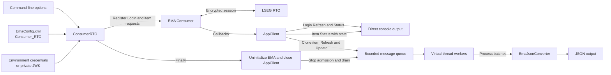

# Building an EMA Java Consumer with Java 17 and Java 21 Features

## Overview

**Last Updated**: September 2026

Java 17 and Java 21 are Long-Term Support (LTS) releases that add useful language and concurrency features to Java applications. However, a feature is easier to understand when we see it solving a real application problem instead of looking at an isolated example.

This article walks through an [Enterprise Message API - Java Edition (EMA Java)](https://developers.lseg.com/en/api-catalog/real-time-opnsrc/rt-sdk-java) consumer that connects to the LSEG Real-Time Optimized (RTO) service. The application requests one or more instruments, receives streaming market data, and converts item Refresh and Update messages to JSON.

The example uses the following modern Java features:

- [Records](https://openjdk.org/jeps/395) and [sealed interfaces](https://openjdk.org/jeps/409) available in Java 17
- [Pattern matching](https://openjdk.org/jeps/441) and [record patterns](https://openjdk.org/jeps/440) in `switch` with Java 21
- The Java 21 [`List.getFirst()` method](https://docs.oracle.com/en/java/javase/21/docs/api/java.base/java/util/List.html#getFirst())
- Java 21 [virtual threads](https://openjdk.org/jeps/444)
- Text blocks, Stream API operations, and immutable lists

The main focus is how these features help the application model requests, route messages, run asynchronous work, and shut down cleanly.

The walkthrough follows `ConsumerRTO.java`, `AppClient.java`, `MessageProcessingPipeline.java`, and `EmaJsonConverter.java`, with a brief look at `Utility.java` where it supports the main flow.

**Note**

This POC is intended for demonstration and educational purposes only and is **not designed for production use**. The source code prioritizes clarity and ease of understanding over performance, scalability, and production-grade practices. Do not use this project as-is in a production environment. The author assumes no responsibility for any issues arising from its use.

## Prerequisites

Before going further, you need the following:

- Java Development Kit (JDK) 21
- Apache Maven
- LSEG RTO access, service entitlements, and network connectivity
- A Version 2 client ID with either a client secret or a private JWK file

Please check that the selected JDK and EMA release are supported in the [RTSDK Java API Compatibility Matrix](https://developers.lseg.com/en/api-catalog/real-time-opnsrc/rt-sdk-java/documentation#api-compatibility-matrix).

The application reads the client ID from the `RTO_CLIENTID_V2_1` environment variable and the client secret from `RTO_CLIENTSECRET_1`. JWK authentication is also supported with the `-jwkFile` option.

> **Security:** Never put a real client ID, client secret, private JWK, proxy password, or keystore password in source code or source control. Use environment variables or an external secret manager.

That covers the prerequisite of this example.

## Application Flow

Let’s start with the basic flow of the application.



The flow can be summarized as follows:

1. `ConsumerRTO` reads command-line options and validates the RTO credentials.
2. It creates an EMA consumer and registers Login and item requests.
3. EMA receives data from RTO and invokes `AppClient` callbacks.
4. Login and Status messages are handled directly.
5. Item Refresh and Update messages are cloned and placed in a bounded queue.
6. Virtual-thread workers process queued messages in batches.
7. `EmaJsonConverter` converts each message to JSON.
8. During shutdown, EMA is uninitialized and the accepted queue content is drained.

Now we can look at each part step-by-step.

## ConsumerRTO: Starting the EMA Consumer

The `ConsumerRTO` class is the application entry point. It owns the startup flow, validates request data, opens the EMA consumer, and guarantees cleanup.

### Default Service, Item, and Field View

The application defaults to the `ELEKTRON_DD` service and the `/THB=` item. These values can be changed with the `-serviceName` and `-itemNames` command-line options.

Each item request also contains a field ID View:

```java
private static final int[] VIEW_FIELD_IDS = {
        3,    // DSPLY_NAME
        11,   // NETCHNG_1
        22,   // BID
        25,   // ASK
        3386, // QUOTE_DATE
        1025  // QUOTIM
};
```

A View asks the service to send only the selected fields instead of every field available for the item. Both single-item and batch requests use the same View in this example.

### Modeling Requests with a Sealed Interface

A request in this application can have only two forms: one item or a batch of items. The code models this rule with a sealed interface:

```java
private sealed interface ItemRequest permits SingleItemRequest, BatchItemRequest {

    static ItemRequest create(String serviceName, String[] itemNames) {
        Objects.requireNonNull(itemNames, "Item names must not be null.");

        List<String> validatedItemNames = Arrays.stream(itemNames)
                .map(itemName -> requireNonBlank(itemName, "Item name"))
                .toList();

        return switch (validatedItemNames.size()) {
            case 0 -> throw new IllegalArgumentException(
                    "At least one item name is required.");
            case 1 -> new SingleItemRequest(
                    serviceName, validatedItemNames.getFirst());
            default -> new BatchItemRequest(serviceName, validatedItemNames);
        };
    }
}
```

A sealed interface is a Java feature that restricts which classes can implement it. Here, the compiler knows that an `ItemRequest` must be either `SingleItemRequest` or `BatchItemRequest`. Another request type cannot appear unexpectedly.

The factory method also demonstrates a few other modern Java APIs:

- A Stream validates every item name.
- `Stream.toList()` returns an unmodifiable list.
- `List.getFirst()` expresses the intention more clearly than `get(0)` for the single-item case.
- A `switch` expression selects and returns the correct request type.

`List.getFirst()` is new in Java 21 through the sequenced collections APIs.

### Storing Request Data with Records

The two permitted request types are records:

```java
private record SingleItemRequest(
        String serviceName,
        String itemName) implements ItemRequest {

    private SingleItemRequest {
        serviceName = requireNonBlank(serviceName, "Service name");
        itemName = requireNonBlank(itemName, "Item name");
    }
}

private record BatchItemRequest(
        String serviceName,
        List<String> itemNames) implements ItemRequest {

    private BatchItemRequest {
        serviceName = requireNonBlank(serviceName, "Service name");
        Objects.requireNonNull(itemNames, "Item names must not be null.");

        itemNames = itemNames.stream()
                .map(itemName -> requireNonBlank(itemName, "Item name"))
                .toList();

        if (itemNames.size() < 2)
            throw new IllegalArgumentException(
                    "A batch request requires at least two item names.");
    }
}
```

Records became final in Java 16 and are available in Java 17. They are designed for small data carriers and automatically provide accessors, equality, hash code, and a readable `toString()` implementation.

The compact constructors above add the business rules:

- A single request must contain exactly one valid item.
- A batch request must contain at least two items.
- Service and item names cannot be blank.
- The batch rebuilds the list so the record does not retain caller-owned mutable data.

This is a good use of records because the application needs immutable request data, not classes with changing internal state.

### Java 21 Record Patterns in switch

The sealed hierarchy becomes more useful when the request is registered with EMA:

```java
switch (itemRequest) {
    case SingleItemRequest(String serviceName, String itemName) ->
            consumer.registerClient(
                    EmaFactory.createReqMsg()
                            .serviceName(serviceName)
                            .name(itemName)
                            .payload(payload),
                    appClient);

    case BatchItemRequest(String serviceName, List<String> itemNames) -> {
        payload.add(EmaFactory.createElementEntry().array(
                EmaRdm.ENAME_BATCH_ITEM_LIST,
                createBatchItemArray(itemNames)));
        consumer.registerClient(
                EmaFactory.createReqMsg()
                        .serviceName(serviceName)
                        .payload(payload),
                appClient);
    }
}
```

Java 21 record patterns unpack the record components directly in each `case`. The code gets `serviceName`, `itemName`, or `itemNames` without manual casts and accessor calls.

There is no `default` branch. Because `ItemRequest` is sealed and every permitted type is handled, the compiler can verify that the `switch` is exhaustive. If a new request type is added later, this `switch` must also be updated or the application will not compile.

For the single request, EMA receives the item name in the request message. For the batch request, item names are placed in the `:ItemList` array inside the request payload. Both forms include the same field View.

### Opening the RTO Session and Registering Requests

The main method brings those pieces together:

```java
OmmConsumerConfig config = EmaFactory.createOmmConsumerConfig();

if (!Utility.readCommandlineArgs(args, config))
    return;

if (!applyEnvironmentCredentials(config))
    return;

appClient = new AppClient();
ItemRequest itemRequest = ItemRequest.create(
        Utility.serviceName, Utility.itemNames);

consumer = EmaFactory.createOmmConsumer(
        config.consumerName(CONSUMER_NAME));

LoginReq loginReq = EmaFactory.Domain.createLoginReq();
consumer.registerClient(loginReq.message(), appClient);

registerItemRequest(consumer, appClient, itemRequest);
Thread.sleep(RUN_DURATION);
```

The sequence is important:

1. Read and validate options.
2. Apply client-secret or JWK authentication details.
3. Validate and normalize the item request before opening the session.
4. Create the EMA consumer using `Consumer_RTO`.
5. Register the Login stream so the application can observe its state.
6. Register the single-item or batch request.
7. Keep the main thread alive while EMA calls the client asynchronously.

EMA session management handles the RTO token and connection workflow based on the supplied authentication and consumer configuration.

### Cleanup and Interruption

The application restores the thread interruption flag and always cleans up successfully created resources:

```java
} catch (InterruptedException exception) {
    Thread.currentThread().interrupt();
    System.err.println("Consumer interrupted: " + exception.getMessage());
} catch (OmmException exception) {
    System.err.println(exception.getMessage());
} finally {
    if (consumer != null)
        consumer.uninitialize();
    if (appClient != null)
        appClient.close();
}
```

`consumer.uninitialize()` closes the EMA session first. Closing `AppClient` then lets its processing pipeline finish accepted work. Restoring the interrupted status is important because it preserves the cancellation signal for higher-level code and runtime tools.

That covers the consumer startup and request model.

## AppClient: Routing EMA Callbacks

Moving on to the callback flow, `AppClient` implements `OmmConsumerClient`. EMA calls its methods when Login and item messages arrive.

The class deliberately separates control messages from data messages:

| Callback message | Handling |
| --- | --- |
| Login Refresh | Decode with EMA Login domain object and output directly |
| Login Status | Decode with EMA Login domain object and output directly |
| Item Refresh | Clone and submit to the asynchronous pipeline |
| Item Update | Clone and submit to the asynchronous pipeline |
| Item Status with state | Output directly |
| Item Status without state | Ignore |
| Generic and Ack | No processing in this example |

### Handling Login Refresh Messages

The Refresh callback first checks the EMA domain type:

```java
@Override
public void onRefreshMsg(RefreshMsg refreshMsg, OmmConsumerEvent event) {
    if (refreshMsg.domainType() == EmaRdm.MMT_LOGIN) {
        loginRefresh.clear();
        outputConsumer.accept(
                loginRefresh.message(refreshMsg).toString() + "\n");
        return;
    }

    pipeline.submitRefresh(EmaFactory.createRefreshMsg(refreshMsg), event);
}
```

A Login Refresh describes the Login stream, so it is decoded with EMA's `LoginRefresh` domain object and written directly. It does not go through the JSON converter.

A non-login Refresh is an item data message. The callback creates a copy with `EmaFactory.createRefreshMsg(refreshMsg)` before sending it to the pipeline.

This clone is essential. EMA owns callback message objects, and application code should not retain the original object for work that continues after the callback returns.

### Handling Update and Status Messages

Updates follow the same clone-before-queue rule:

```java
@Override
public void onUpdateMsg(UpdateMsg updateMsg, OmmConsumerEvent event) {
    pipeline.submitUpdate(EmaFactory.createUpdateMsg(updateMsg), event);
}
```

Status messages stay outside the asynchronous data pipeline:

```java
@Override
public void onStatusMsg(StatusMsg statusMsg, OmmConsumerEvent event) {
    if (statusMsg.domainType() == EmaRdm.MMT_LOGIN) {
        loginStatus.clear();
        outputConsumer.accept(
                loginStatus.message(statusMsg).toString() + "\n");
    } else if (statusMsg.hasState()) {
        outputConsumer.accept(statusMsg.toString() + "\n");
    }
}
```

A Login Status is decoded with `LoginStatus`. A non-login Status is written only when it contains state information, such as an open, closed, or suspect stream state. A Status without state produces no output.

This keeps Login and stream-state information easy to see while reserving JSON conversion for item Refresh and Update data.

## MessageProcessingPipeline: Bounded Work with Virtual Threads

Now we come to the main concurrency part of the application. `MessageProcessingPipeline` moves JSON conversion away from EMA callback threads.

The example uses these tuning values:

| Setting | Value | Purpose |
| --- | ---: | --- |
| Worker count | `5` | Number of long-running processing tasks |
| Queue capacity | `1,000` | Maximum messages waiting for processing |
| Batch size | `50` | Maximum messages handled in one batch |
| Poll interval | `100 ms` | How long a worker waits for the next message |
| Shutdown timeout | `10 s` | Maximum normal worker shutdown wait |

### Virtual-thread Worker Executor

The constructor creates a bounded queue and a virtual-thread-per-task executor:

```java
this.messageQueue = new LinkedBlockingQueue<>(queueCapacity);
this.outputConsumer = Objects.requireNonNull(
        outputConsumer, "Output consumer must not be null.");
this.workerExecutor = Executors.newVirtualThreadPerTaskExecutor();

for (int workerIndex = 0; workerIndex < workerCount; workerIndex++)
    workerExecutor.submit(this::processBatches);
```

Virtual threads became a final feature in Java 21. They are lightweight Java threads managed by the runtime. They are useful when tasks spend time waiting, such as workers polling a queue or writing output, because an application can use them without creating the same number of expensive operating-system threads.

This example submits five long-running worker tasks. The virtual-thread executor creates one virtual thread for each worker task, while the bounded queue controls how much pending data the application retains.

Virtual threads do not remove the need for overload control. An incoming market data stream can still be faster than JSON conversion or its output destination. That is why queue capacity remains important.

### Immutable Queued Messages with Records and Sealed Types

The pipeline uses another closed hierarchy:

```java
private sealed interface QueuedMessage
        permits QueuedRefresh, QueuedUpdate {
    long sequence();
    EventContext eventContext();
    Msg message();
}

private record QueuedRefresh(
        long sequence,
        EventContext eventContext,
        RefreshMsg message) implements QueuedMessage {
}

private record QueuedUpdate(
        long sequence,
        EventContext eventContext,
        UpdateMsg message) implements QueuedMessage {
}

private record EventContext(
        long handle,
        long parentHandle,
        String closure) {

    private static EventContext capture(OmmConsumerEvent event) {
        return new EventContext(
                event.handle(),
                event.parentHandle(),
                String.valueOf(event.closure()));
    }
}
```

`QueuedRefresh` and `QueuedUpdate` carry a cloned EMA message, a sequence number, and immutable callback details. `EventContext.capture()` copies the values needed later instead of keeping the callback-owned `OmmConsumerEvent` object.

Once again, records reduce boilerplate and the sealed interface tells the compiler the complete set of queued message types.

### Bounded Admission and Drop-newest Behavior

Submitting a message increments a monotonic sequence and captures its callback context:

```java
void submitUpdate(UpdateMsg updateMsg, OmmConsumerEvent event) {
    enqueue(new QueuedUpdate(
            sequence.incrementAndGet(),
            EventContext.capture(event),
            updateMsg));
}

private void enqueue(QueuedMessage queuedMessage) {
    synchronized (admissionLock) {
        if (closing || !messageQueue.offer(queuedMessage))
            droppedMessages.incrementAndGet();
    }
}
```

`offer()` does not wait for queue space. If the bounded queue is full, the newest incoming message is dropped and counted. This protects the application from unbounded memory growth.

The sequence number counts callback admission attempts. Therefore, dropped messages leave gaps in the sequence values written to JSON. Those gaps can help reveal overload.

The admission lock also coordinates submission with shutdown. Once closing begins, a new message cannot be accepted while workers are draining the queue.

### Processing Messages in Batches

Each worker waits for one message and then drains more available messages into the same batch:

```java
while (!closing || !messageQueue.isEmpty()) {
    QueuedMessage queuedMessage = messageQueue.poll(
            WORKER_POLL_INTERVAL.toMillis(),
            TimeUnit.MILLISECONDS);
    if (queuedMessage == null)
        continue;

    batch.add(queuedMessage);
    messageQueue.drainTo(batch, BATCH_SIZE - 1);
    batch.forEach(this::convertAndWrite);
    batch.clear();
}
```

The first `poll()` avoids a busy loop when there is no data. `drainTo()` then collects up to 49 more messages, making a maximum batch of 50. Batching reduces repeated queue operations when messages arrive quickly.

The queue admits messages in FIFO order, but five workers can complete their batches at different times. Therefore, JSON output order is not guaranteed to match callback arrival order. Consumers of the output should use the `sequence` property when they need to identify the original admission order.

### Exhaustive Message Dispatch

The pipeline uses Java 21 pattern matching for `switch` to name each queued type:

```java
private static String messageType(QueuedMessage queuedMessage) {
    return switch (queuedMessage) {
        case QueuedRefresh ignored -> "Refresh";
        case QueuedUpdate ignored -> "Update";
    };
}
```

No cast or `instanceof` chain is required. There is also no `default` because the sealed interface makes the two cases exhaustive.

Each conversion has its own `try` block. A malformed message or output failure is reported, but it does not terminate the worker and prevent later messages from being processed.

### Graceful Shutdown

Closing the pipeline first stops admission, then requests executor shutdown:

```java
synchronized (admissionLock) {
    closing = true;
}
workerExecutor.shutdown();

if (!workerExecutor.awaitTermination(
        SHUTDOWN_TIMEOUT.toMillis(), TimeUnit.MILLISECONDS)) {
    List<Runnable> abandonedWorkers = workerExecutor.shutdownNow();
    System.err.printf(
            "JSON workers did not stop cleanly; "
                    + "%d worker tasks were abandoned.%n",
            abandonedWorkers.size());
}
```

During normal shutdown, workers continue while the queue is not empty. This drains messages that were accepted before closing started.

If workers do not finish within ten seconds, `shutdownNow()` interrupts them. For that reason, normal close aims to process every accepted message, but the application does not promise unconditional delivery during a forced timeout or process termination.

The pipeline finally reports how many incoming messages were dropped.

That covers the virtual-thread processing pipeline.

## EmaJsonConverter: Converting Item Data to JSON

`EmaJsonConverter` is a stateless utility class. It receives only cloned messages and copied callback details, then returns one complete JSON string.

### Building the JSON Message

The converter starts with callback and EMA message metadata:

```java
JSONObject json = new JSONObject()
        .put("sequence", sequence)
        .put("type", messageType)
        .put("handle", handle)
        .put("parentHandle", parentHandle)
        .put("closure", closure)
        .put("streamId", msg.streamId())
        .put("domainType", msg.domainType())
        .put("itemName", msg.hasName() ? msg.name() : NOT_SET)
        .put("serviceName",
                serviceName != null ? serviceName : JSONObject.NULL);

if (msg instanceof RefreshMsg refreshMsg)
    json.put("state", stateToJson(refreshMsg.state()));
```

A Refresh includes stream state, while an Update does not. The state object contains the stream state, data state, status code, and status text.

The converter adds both message attributes and payload. A `FieldList` is expanded into JSON fields. Other EMA container types are identified by their data type but are not fully expanded by this example.

### Pattern Matching for Message Types

The concrete EMA message type determines how the service name is read:

```java
private static String serviceName(Msg msg) {
    return switch (msg) {
        case RefreshMsg refreshMsg -> refreshMsg.hasServiceName()
                ? refreshMsg.serviceName()
                : null;
        case UpdateMsg updateMsg -> updateMsg.hasServiceName()
                ? updateMsg.serviceName()
                : null;
        default -> null;
    };
}
```

This is a Java 21 type-pattern `switch`. Unlike the application’s sealed request and queue models, EMA's base `Msg` type is not closed to only these two cases. The `default` branch is therefore needed.

### Pattern Matching for Field Values

The FieldList converter also uses a type-pattern `switch`:

```java
return switch (fieldEntry.load()) {
    case OmmReal real -> Double.toString(real.asDouble());
    case OmmDate date -> "%d / %d / %d".formatted(
            date.day(), date.month(), date.year());
    case OmmTime time -> "%d:%d:%d:%d".formatted(
            time.hour(), time.minute(),
            time.second(), time.millisecond());
    case OmmInt intValue -> Long.toString(intValue.intValue());
    case OmmUInt uintValue -> Long.toString(uintValue.longValue());
    case OmmAscii ascii -> ascii.ascii();
    case OmmEnum enumValue -> fieldEntry.hasEnumDisplay()
            ? fieldEntry.enumDisplay()
            : Integer.toString(enumValue.enumValue());
    case OmmRmtes rmtes -> rmtes.rmtes().toString();
    case OmmError error -> "(" + error.errorCodeAsString() + ")";
    default -> fieldEntry.load().toString();
};
```

Before this `switch`, an EMA blank is returned as `null`. The pattern variables such as `real`, `date`, and `ascii` already have the correct type inside their branch. This replaces a longer sequence of type checks and casts with one readable expression.

A converted item message has a shape similar to the following shortened example:

```json
{
  "sequence": 1,
  "type": "Refresh",
  "handle": 3,
  "parentHandle": 2,
  "streamId": 5,
  "domainType": 6,
  "itemName": "/THB=",
  "serviceName": "ELEKTRON_DD",
  "state": {
    "stream": "Open",
    "data": "Ok",
    "code": "None",
    "text": ""
  },
  "payload": {
    "dataType": "FieldList",
    "fields": [
      {
        "FID": 22,
        "FieldName": "BID",
        "dataType": "Real",
        "value": "32.15"
      }
    ]
  }
}
```

Only item Refresh and Update messages take this JSON path. Login and all Status messages bypass `EmaJsonConverter`.

## Utility and Command-line Options

The `Utility` class supports command-line parsing, help output, TLS selections, proxy settings, and private JWK loading. It also stores the default request values:

```java
static String serviceName = "ELEKTRON_DD";
static String[] itemNames = {"/THB="};
```

The most relevant options for this walkthrough are:

| Option | Purpose |
| --- | --- |
| `-?` | Show command-line help |
| `-serviceName <name>` | Select the service |
| `-itemNames <items>` | Supply one item or a comma-separated batch |
| `-jwkFile <file>` | Load a private JWK for Version 2 authentication |
| `-audience <value>` | Set the JWT audience |
| `-spTLSv1.2` | Select TLS 1.2 |
| `-spTLSv1.3` | Select TLS 1.3 |

If neither TLS-specific option is supplied, both TLS 1.2 and TLS 1.3 are enabled. `Utility` also uses a Java text block for its multi-line help text and Stream operations to trim and filter comma-separated item names.

The application can be run from the project root for one item:

```bash
java -jar target/ema-consumer-java21-1.0.jar \
  -serviceName ELEKTRON_DD \
  -itemNames "/THB="
```

Or for a batch:

```bash
java -jar target/ema-consumer-java21-1.0.jar \
  -serviceName ELEKTRON_DD \
  -itemNames "AUD=,HKD=,JPY="
```

Running from the project root is important because EMA discovers the external `EmaConfig.xml` file from the process working directory.

## Tests in Brief

The project contains focused tests for the behavior described in this article:

- `AppClientTest` verifies Login decoding, state-bearing item Status output, ignored stateless Status messages, and callback routing.
- `MessageProcessingPipelineTest` verifies queue processing, overload behavior, batching-related flow, and shutdown.
- `EmaJsonConverterTest` verifies message metadata, state, FieldList values, and JSON conversion.

The tests also use small worker and queue settings so the asynchronous behavior can be checked without changing the example defaults.

## Java 17 and Java 21 Feature Summary

The modern Java features are not used only for syntax. Each one supports a specific part of the EMA application design.

| Java feature | Project usage | Practical benefit |
| --- | --- | --- |
| Records | Item requests, queued messages, event context | Compact immutable data carriers |
| Sealed interfaces | Request and queued-message hierarchies | Closed and compiler-known models |
| Record patterns in `switch` | Single and batch request registration | Unpack records without casts |
| Type-pattern `switch` | Queued message and EMA value conversion | Clear type-based dispatch |
| Exhaustive `switch` | Sealed request and queue models | Compiler reports missing cases |
| `List.getFirst()` | Single-item request selection | States the intention directly |
| Virtual threads | Long-running JSON workers | Lightweight asynchronous tasks |
| Text blocks | Command-line help | Readable multi-line strings |
| Stream API and `toList()` | Item parsing and validation | Concise transformations and immutable results |

One important distinction is that records were finalized before Java 17, but they are part of the modern Java feature set available to Java 17 applications. Record patterns, pattern matching for `switch`, sequenced collection methods such as `getFirst()`, and virtual threads became final features in Java 21.

## Conclusion

This EMA consumer shows how Java 17 and Java 21 features can work together in a practical streaming application.

`ConsumerRTO` uses records and a sealed interface to represent valid single and batch requests. Java 21 record patterns then register each request without manual casts. `AppClient` keeps EMA callbacks small by handling Login and Status messages directly and cloning item data for later work. `MessageProcessingPipeline` combines a bounded queue, immutable record messages, batching, and virtual-thread workers. Finally, `EmaJsonConverter` uses type-pattern switches to turn EMA messages and field values into readable JSON.

The most important point is not to use every new Java feature. It is to use each feature where it makes the application rules clearer: closed models for known alternatives, immutable records for transferred data, exhaustive switches for routing, and virtual threads for lightweight concurrent work.

That covers the EMA Java application and its Java 17 and Java 21 features.

## References

For further details, please check the following resources:

- [Enterprise Message API - Java Edition](https://developers.lseg.com/en/api-catalog/real-time-opnsrc/rt-sdk-java)
- [EMA and ETA Java APIs RTO with Version 2 Authentication Quickstart](https://developers.lseg.com/en/api-catalog/real-time-opnsrc/rt-sdk-java/quick-start#rtsdk-ema-eta-quick-start-connecting-to-the-real-time-optimized-with-authentication-version-2)
- [RTSDK Java Documentation](https://developers.lseg.com/en/api-catalog/real-time-opnsrc/rt-sdk-java/documentation)
- [Real-Time SDK on GitHub](https://github.com/Refinitiv/Real-Time-SDK)
- [Java Language Updates for Java 17](https://docs.oracle.com/en/java/javase/17/language/java-language-changes.html)
- [Record Classes](https://docs.oracle.com/en/java/javase/17/language/records.html)
- [Sealed Classes and Interfaces](https://docs.oracle.com/en/java/javase/17/language/sealed-classes-and-interfaces.html)
- [Pattern Matching in Java 21](https://docs.oracle.com/en/java/javase/21/language/pattern-matching.html)
- [Sequenced Collections](https://docs.oracle.com/en/java/javase/21/core/creating-sequenced-collections-sets-and-maps.html)
- [Virtual Threads](https://docs.oracle.com/en/java/javase/21/core/virtual-threads.html)
